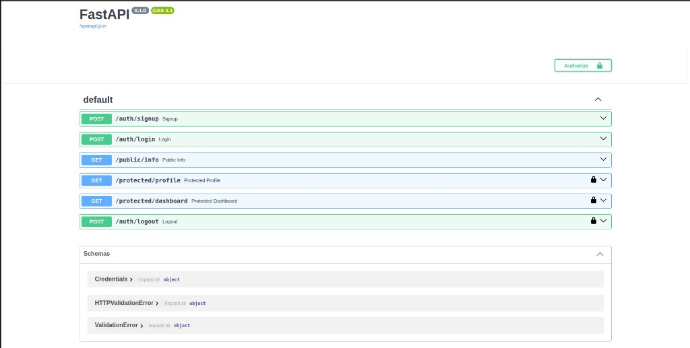

# Auth Login & Protect

Authentication API built with FastAPI and Supabase Auth. The client signs up and logs in through Supabase, receives a JWT, and sends that token in the `Authorization` header to reach protected routes.

## About the project

Supabase is the identity provider: it stores the password and issues the access token. This API does not store passwords. It validates the request body, forwards sign-up and login to Supabase, and checks the token with `get_user` before answering a protected route.

## Architecture

Everything lives in `main.py`.

- `signup` and `login` talk to `supabase.auth`.
- `extract_bearer_token` reads the `Authorization: Bearer <token>` header.
- `require_user` is the reusable dependency. It rejects a missing or invalid token, and only then lets the route run.
- `HTTPBearer` publishes the padlock in Swagger. `auto_error=False` keeps the **401** status and the `error` key.

## Prerequisites

- Python 3.10 or newer
- A project on [Supabase](https://supabase.com)
- The port set in `PORT` must be free. The default is `8000`.

## Setup

1. Create a Supabase project.
2. Under **Authentication → Sign In / Providers → Email**, turn off **Confirm email** for this exercise. While that option is on, the free plan sends only two emails per hour, and login does not return a session until the address is confirmed.
3. In the **Connect** dialog, copy the Project URL and the publishable key (`sb_publishable_...`). On the older dashboard this key is called the anon key. Do not use the secret key or the service role key.

```bash
python3 -m venv .venv
source .venv/bin/activate
pip install -r requirements.txt
cp .env.example .env
```

Fill `.env` with your own values. That file is listed in `.gitignore` and must not be committed.

```env
SUPABASE_URL=https://your-project.supabase.co
SUPABASE_KEY=your_publishable_key
PORT=8000
```

## Run

```bash
source .venv/bin/activate
python main.py
```

The terminal prints `Server running and connected to Supabase`. Interactive docs are at [http://localhost:8000/docs](http://localhost:8000/docs).

## Routes

| Method | Path | Auth | Success |
| --- | --- | --- | --- |
| POST | `/auth/signup` | no | 201 |
| POST | `/auth/login` | no | 200 |
| POST | `/auth/logout` | Bearer | 204 |
| GET | `/public/info` | no | 200 |
| GET | `/protected/profile` | Bearer | 200 |
| GET | `/protected/dashboard` | Bearer | 200 |

Sign-up and login body:

```json
{ "email": "user@email.com", "password": "your-password" }
```

Protected routes require:

```http
Authorization: Bearer <access_token>
```

| Situation | Status |
| --- | --- |
| Email or password missing or empty | 400 |
| Wrong login credentials | 401 |
| Missing or malformed token | 401 |
| Invalid or expired token | 401 |
| Logout completed | 204 |

In Swagger, click **Authorize** and paste only the `access_token`, without the word `Bearer`.

## Swagger UI



## Tests

There are no automated tests yet. Check the API by hand while it is running.

```bash
curl -i http://localhost:8000/public/info

curl -i -X POST http://localhost:8000/auth/login \
  -H "Content-Type: application/json" \
  -d '{"email":"user@email.com","password":"your-password"}'

curl -i http://localhost:8000/protected/profile \
  -H "Authorization: Bearer YOUR_ACCESS_TOKEN"
```

`/public/info` returns **200**. `/protected/profile` without a token returns **401**. With a valid access token, it returns **200** and the user's `id`, `email`, and `created_at`.
